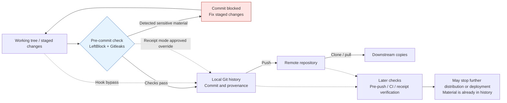
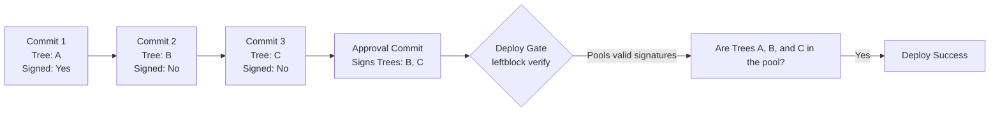

# LeftBlock

**LeftBlock** is a pluggable inspection gate for Git commits. It runs configured scanners, including Gitleaks, on staged changes. Local check-only mode blocks findings before a commit; optional receipt mode also records the inspection result in an HMAC receipt.

LeftBlock **shifts privacy checks left**: detected sensitive material can be blocked before it enters a commit and becomes part of local Git history. Pushing distributes that history to a remote; subsequent clones and pulls distribute it further. A later check can stop the next step, but cannot undo copies already made.



Local check-only mode installs a Git **`pre-commit` hook**. Receipt mode installs a **`commit-msg` hook**, which runs later but still before Git creates the commit object. The local hook offers no interactive override and adds no receipt; a false alarm can be handled only by a recorded, reasoned override that is committed and reviewable (see [Overriding a false alarm](#overriding-a-false-alarm)). The default Gitleaks command scans the staged diff, not every working-tree file or all existing history. Staging may already write blobs to the local object database, so blocking a commit does not erase every local copy.

This is a layered defense, not a guarantee that a repository contains no sensitive information. Scanners can miss formats or context, allowlists and configuration affect coverage, and hooks can be bypassed with `--no-verify` or disabled. In receipt mode, interactive approval can intentionally override findings. Missing scanners, invalid configuration, or other checker errors block the commit without an override. Use review, narrowly scoped exceptions, and independent checks before pushing or deploying as additional layers.

`leftblock verify` validates receipts; it does not rescan content, and a valid receipt can record an approved override. The HMAC binds the recorded result to a tree hash, but anyone who can read the shared secret can mint a receipt. LeftBlock does not itself isolate that secret from an agent running as the same user.

---

## Project and release status

LeftBlock has been donated to **Data Parade (`DataParade-io`)**, alongside
BotSpy. Its repository is
[DataParade-io/LeftBlock](https://github.com/DataParade-io/LeftBlock).

LeftBlock is published on PyPI as `leftblock`. The current source uses `leftblock` as its
distribution, Python package, and CLI name. It includes no earlier package
aliases or command shims. The CLI is also available as
`python -m leftblock.cli`.

Current receipt-mode configuration uses `.leftblock.yml`, `.leftblock/`
rule paths, `LEFTBLOCK_SECRET_PATH`, and `leftblock-*` rule IDs. New receipts
use the `leftblock-v1` validator for configuration version 1. Earlier
configuration filenames, environment-variable names, and hook ownership
records are not migrated automatically.

### Migrating an earlier installation

This release does not remove or replace a separately installed earlier
distribution, and it does not rewrite published releases or Git history.
That does **not** make an existing installation automatically compatible:
an editable install or hook may still load code from the checkout being
updated. Before pulling these changes into such a checkout:

1. Inventory each protected repository's common Git directory, hook manager,
   interpreter, installed package, checker policy, rules, and secret location.
   Linked worktrees share their common Git metadata; coordinate them together.
2. Prepare and test the new runtime independently. Retain the working earlier
   runtime and protection until the replacement has passed validation.
3. Review and migrate policy paths and rule IDs to the current names. Preserve
   custom rules, narrow exceptions, owner edits, and existing hook-manager
   behavior. Do not replace an edited or foreign hook to force installation.
4. For receipt mode, retain the **same secret bytes**. Securely migrate the
   existing file to the new default location, or set `LEFTBLOCK_SECRET_PATH`
   to its existing absolute path in the hook and verifier environments.
   Do not print the secret, commit it, or run an installer that generates a
   replacement secret as a shortcut. New receipt installation is not a
   credential migration tool.
5. Coordinate the runtime, policy, hook command and ownership-state transition.
   Keep a rollback path and existing protection until the new setup accepts
   clean fixtures, blocks synthetic sensitive fixtures without advancing
   `HEAD`, and verifies the required historical receipt range.

Historical receipts must remain byte-for-byte unchanged. Verification reads
and authenticates the validator string stored in each receipt, so a naming
change does not require resigning history when the original secret is
available. This is a migration checklist, not an automatic migration or a
claim that existing repositories have already been upgraded.

## Quick Start

LeftBlock is built in Python and requires `git`. Install Gitleaks separately
from a trusted source and confirm `gitleaks version` works. LeftBlock
configures the integration; it does not install scanner binaries.

**1. Install the CLI:**

In the intended Python environment:

```bash
python -m pip install leftblock==0.3.5
python -m leftblock.cli --help
```

Follow the migration checklist above before replacing an earlier setup.

**2. Enable local staged protection:**

```bash
cd my-repo
leftblock install --local --check-only
```

This mode installs a managed `pre-commit` hook and keeps its policy in the
repository's common Git metadata directory. It creates no signing secret,
adds no commit receipts, and writes no tracked repository files. Linked
worktrees share that metadata and hook, so coordinate setup across them.
To select a specific existing Gitleaks executable, pass its absolute path:

```bash
leftblock install --local --check-only --gitleaks "$(command -v gitleaks)"
```

The installer preserves existing hooks and refuses to overwrite a foreign
or edited hook. An unchanged hook managed by LeftBlock can be refreshed.
A configured `core.hooksPath` is left untouched; compose the check explicitly
with the existing hook manager instead of replacing it. An earlier hook
without the current ownership record requires a reviewed migration even
if it is still functional.

#### Upgrades and the stable runtime link

When `install --local --check-only` runs from a virtualenv, it also keeps two
symlinks pointing at that environment:

- `$LEFTBLOCK_HOME/current` (default `~/.local/share/leftblock/current`) points
  at the virtualenv, and every managed hook runs `current/bin/python` instead
  of a versioned interpreter path.
- `~/.local/bin/leftblock` points at `current/bin/leftblock`. It is replaced
  only if it is absent or already a symlink; a regular file is left alone.

To upgrade, install the new version into a new virtualenv and run
`leftblock install --local --check-only` once, in any repository. That
repoints `current`, so every repository's hook uses the new runtime. The
per-repository rules copy (in `.git/leftblock/`) is refreshed only when
you re-run the install in that repository.

If the runtime link is broken, the hook fails closed: it prints
`LeftBlock is not installed at <path>` with the reinstall steps and exits 1.
Outside a virtualenv, the hook keeps using the installing interpreter and no
links are made.

`leftblock --version` prints the installed version. A blocked check starts
with `leftblock <version>, ruleset <id>`, where the ruleset id is the first 12
hex characters of the SHA-256 of the gitleaks config file the checker names
with `--config` (`unknown` when there is none), so a report can say exactly
which rules ran.

#### Dry run

`leftblock check` is a dry run of the next commit: it inspects the staged
changes with the same policy the hook uses and changes nothing. Without
`--config` it uses the local install policy when one exists, otherwise
`.leftblock.yml`. A blocked run ends by printing `Re-run this check:
leftblock check` and the final summary line.

To run a noninteractive staged check with an explicit policy:

```bash
leftblock check --config /absolute/path/to/policy.yml
```

Use the actual policy path for the repository. The command returns a
nonzero status for findings, unavailable scanners, or an invalid setup;
it offers no interactive override, only the recorded override described
below. Before adopting a hook in another project,
verify that a synthetic sensitive fixture is blocked and a clean fixture
passes in a throwaway repository. Keep private policy files in local Git
metadata or another private location.

### Overriding a false alarm

A block stays the default. If a finding is a false alarm (for example a
public role address in a privacy notice), record a reviewed override. The
blocked check prints each finding as `file:LINE: rule [id …] (description)`,
where the description is the rule's own text from the ruleset, never the
matched value, source line or secret, and then the exact command to run:

```bash
leftblock allow ID [ID ...] --reason "Why this is not sensitive"
```

`allow` re-runs the checks on the staged changes, appends one entry per id
to `.leftblock-allow.yml` at the repository root, and stages that file. It
never commits. The reason is required and must be at least 10 characters.
An entry looks like:

```yaml
version: 1
allow:
  - id: "3f2a9c1e7b4d5a60"
    rule: "leftblock-personal-email"
    file: "apps/web/privacy/page.tsx"
    kind: "Personal email address"
    reason: "Public role address required in the privacy notice."
    added: 2026-10-20
```

- **Category for reviewers.** `kind` is the rule's description, written so a
  reviewer of the pull request sees what kind of finding was approved. It is
  informational: it is not part of matching and may be omitted.
- **Scoped to line content.** The id hashes the rule, the file, and the exact
  staged content of the flagged lines. Editing that line, or adding another
  finding anywhere, blocks again.
- **Staged to count.** Only the version of `.leftblock-allow.yml` in the Git
  index is read, so the override is always part of the commit and its review.
  A file that is only in the working tree has no effect.
- **Visible every time.** Each run prints the file, rule, id, and reason of
  every applied override.
- **Fail closed.** Invalid YAML, an unsupported version, an entry missing
  `id`, `rule`, or `file`, or a reason under 10 characters blocks the commit.
  Scanner errors are never overridden, and a finding with no id (its lines
  could not be read) must be removed instead.
- **Configuration.** Without `--config`, `allow` uses the local install's
  policy when present, otherwise `.leftblock.yml`; pass the same `--config`
  you use for `check` if it differs.

This mechanism is separate from Gitleaks' own suppressions: inline
`gitleaks:allow` markers and a root `.gitleaksignore` are still honoured by
Gitleaks itself, and they are outside this mechanism's reason, scope, and
review trail.

During an in-progress merge, command checkers skip only regular files whose
complete blob and mode already exist at the same path in a parent. Changed
resolutions and renamed destinations retain their full staged diff, so
inherited material in a modified file can still block. If merge scoping
fails, the full staged check runs. Tactus uses the original index.
This does not rescan parent history or eliminate staged-diff limitations,
including sensitive context assembled only by deleting lines.

**3. Optionally enable inspection receipts:**

```bash
leftblock install
```

Receipt mode installs a `commit-msg` hook, creates a shared secret if one
is absent, and writes defaults when they do not already exist:

- `.leftblock.yml` — checker configuration
- `.leftblock/gitleaks.toml` — the shipped sensitive-data ruleset

Existing files at the current configuration and ruleset paths are not
overwritten. Other hooks are preserved. Earlier path names are not discovered
or migrated automatically. The default receipt-mode configuration uses
Gitleaks with redacted output:

```yaml
version: 1
checkers:
  - name: gitleaks
    type: command
    command: gitleaks protect --staged --config .leftblock/gitleaks.toml --redact --no-banner --report-format json --report-path {report_file}
    success_codes: [0]
    finding_codes: [1]
```

The installed hook pins its Python environment and preserves the installation
PATH so it can find configured scanners. Review the hook after moving its
Python environment or Gitleaks executable. For manual composition, run
`leftblock check --config PATH` in the existing `pre-commit` flow and
`leftblock hook "$1"` in the `commit-msg` flow when receipts are needed.
Preserve existing behavior and propagate any failure's exit status.

Receipts use HMAC trailers, not Git GPG/SSH signatures; they do not appear
in `git log --show-signature`. Every machine running `leftblock verify`
needs the same secret, stored by default at `~/.config/leftblock/secret`
or the path in `LEFTBLOCK_SECRET_PATH`. Preserve the existing secret during
migration so historical receipts remain verifiable. Local check-only mode
does not need this secret.

**4. Add independent checks before distribution or deployment:**

For projects using receipts, verify the appropriate incoming commit range:

```bash
leftblock verify HEAD~5..HEAD
```

Choose the range for the pipeline rather than assuming every push contains
five commits. Receipt verification needs the shared secret and neither
rescans content nor rejects valid overrides. Use an independent secret scan
as another layer. A project using only local check-only mode does not mint
the receipts required by this gate.

---

## Out-of-the-Box Detection

LeftBlock ships a Gitleaks ruleset (copied to `.leftblock/gitleaks.toml` in receipt mode) that
extends gitleaks' default secret rules with personal-data and crypto-wallet
rules. These patterns provide a starting point for detection; they do not
cover every kind of sensitive information.

**Covered by gitleaks defaults:** AWS credential pairs, Google/Gemini API keys
(`AIza...`, default `gcp-api-key` rule), generic API keys in keyword context,
PEM private keys, and other standard secret formats.

**Added by the LeftBlock ruleset:**

| Rule | What it catches |
|---|---|
| `leftblock-personal-email` | Personal email addresses (infrastructure identities like `git@github.com`, `@users.noreply.github.com` and `@example.*` placeholders are allowlisted) |
| `leftblock-home-path-posix` | Home-folder paths `/Users/<name>`, `/home/<name>` |
| `leftblock-home-path-windows` | `C:\Users\<name>` and `\Users\<name>` |
| `leftblock-session-uuid` | Potential session UUIDs, with narrow exceptions for canonical Kanbus structural fields and example values |
| `leftblock-actor-id` | `actor_id` / `user_id` / `author_id` JSON values |
| `leftblock-openai-key` | `sk-`, `sk-proj-`, `sk-svcacct-` OpenAI keys |
| `leftblock-anthropic-key` | `sk-ant-` Anthropic keys |
| `leftblock-eth-private-key` | Ethereum-style private keys (`0x` + 64 hex) |
| `leftblock-wif-key` | Bitcoin WIF private keys (compressed `K/L/M…`, uncompressed `5…`) |
| `leftblock-bip39-mnemonic` | BIP-39 seed phrases (12–24 words) in seed/mnemonic/recovery context |

Kanbus exceptions apply to complete identifier property lines in
`project/issues/*.json` and `project/events/*.json`. Event actor attribution
must occupy a root property line in the canonical two-space format.
Coordination claim references must occupy the canonical payload depth.
The legacy `project/.cache/index.json` allows only canonical issue ID/parent
lines and issue-filename keys with numeric modification times; cached
descriptions and comments still receive the normal checks.
Provider session fields, nested actor values, prose and arbitrary arrays
remain scanned. A project prefix alone grants no exception, and a second
value on the same line cannot inherit one. These checks recognize syntax;
they do not validate a full JSON schema or prove an identifier is public.
Other secret rules still apply to values in the accepted fields.

### Crypto wallet material: what is and is not flagged

- **Flagged:** `0x`-prefixed 64-hex private keys, WIF-format Bitcoin keys,
  and 12/15/18/21/24-word BIP-39 seed phrases when they appear in
  seed/mnemonic context (`seed_phrase = "..."`, `recovery mnemonic: ...`).
- **Not flagged on their own:** public wallet addresses (Ethereum `0x` + 40
  hex, Bitcoin base58 addresses) and hash-like hex — SHA-256 digests, git
  SHAs, SHA-512. A bare 64-hex string with no `0x` prefix and no key-like
  keyword is shape-identical to a SHA-256 digest and git SHA, so it is
  deliberately only reported when keyword context (e.g. `private_key = …`)
  indicates it is a key. This trades a small residual gap (a bare,
  unlabeled 64-hex private key stored without any keyword) for not
  drowning developers in digest false positives. BIP-39 checksum
  validation is future validator work; phrase detection is shape- and
  context-based, so unlabeled bare word sequences that read like prose
  are not flagged.

### Why Gitleaks is the default checker

The earlier scanner evaluation used a synthetic fixture corpus, clean
content, and a ~2 MB repository tree. Gitleaks results below include the
LeftBlock ruleset; these measurements describe that corpus, not a guarantee
about other repositories or scanner versions:

| Scanner | Verdict |
|---|---|
| **Gitleaks 8.30.1** (default checker) | Catches API keys, crypto keys (with the LeftBlock ruleset), and personal data via custom rules; deterministic exit codes (0 clean / 1 findings); zero false positives on clean content and on the real tree with the shipped ruleset; fast (~35 ms on 2 MB). |
| detect-secrets | No OpenAI/AWS-type detector hits for these formats — findings appear only as generic "High Entropy String"/"Secret Keyword"; misses mnemonics and all personal data; exit code 0 even with findings, so not gate-suitable without a wrapper. |
| TruffleHog (offline) | Its AWS detector caught the credential pair, but nothing else offline (OpenAI/Anthropic/Gemini/crypto/personal data all missed); scans git objects including gitignored files, which produces a different, noisier finding set; no allowlist mechanism for custom detectors. |
| Presidio | Built for PII text analytics; requires a 500 MB model, flags benign URLs/IPs/timestamps while missing every target category here (including `.test`-TLD emails and keys); unsuitable for commit gating. |

False-positive measurements with the shipped ruleset: **0 findings** on a
clean corpus (benign source/config files, placeholder emails and paths that
must stay allowed) and **0 findings** on a ~2 MB real repository tree
(LEFTBLOCK_DOGFOOD_TREE dogfood test). The unit-test suite
(`tests/test_sensitive_rules.py`) regenerates all fixtures synthetically at
test time from a seeded RNG — no real credential ever appears in the repo.

---

## Custom Agent-Based Scanning (Tactus)

While standard tools like Gitleaks are great for finding AWS IAM keys, they struggle with subtle, context-dependent leaks—like mentioning a confidential client's name or proprietary business logic.

LeftBlock supports **Tactus procedures** for agent-based code review.

### Example: Protecting Confidential Client Names
Imagine you have a list of highly confidential clients that should never be mentioned in your repository's source code.

1. Create a `.gitignored` file named `confidential_clients.txt`.
2. Write a Tactus procedure (e.g., `check_clients`) that reads `confidential_clients.txt` and scans the staged files to ensure none of those names appear.
3. Add the procedure to your `.leftblock.yml`:

```yaml
version: 1
checkers:
  - name: tactus-confidentiality-scan
    type: tactus
    procedure: check_clients
```

In receipt mode, LeftBlock invokes a configured Tactus checker when a commit is made. If Tactus finds a leaked client name, it exits with an error, LeftBlock blocks the commit, and prompts a human for an override password. If the code is clean, the signature is minted and the commit proceeds.

---

## Deep Dive: How it works

### 1. The Commit Hook
Receipt mode uses a shared HMAC secret.

In receipt mode, before Git creates the commit, LeftBlock:

1. Computes the hash of the staged Git tree.
2. Runs the configured scanners. The default Gitleaks command checks the staged diff; custom checkers define their own scope.
3. If checks pass, records the result and tree hash in an HMAC receipt and appends it to the commit message as Git trailers. An approved interactive override is recorded as an override, not as a clean result.

The tree hash identifies the staged snapshot. It does not imply that the
scanner examined every file in that snapshot or the repository's history.

```text
Inspected-by: leftblock-v1
Inspection-tree: f18588e0c5f5b0a5ba281b5a78242127919d2388
Inspection-result: clean
Inspection-at: 2026-08-31T17:01:34Z
Inspection-sig: hmac-sha256:8cce6e3714782d025eb4ec4aec755...
```

### 2. Retroactive Approval (Signature Pooling)
Because Git commit hashes change if you modify a commit message, you cannot simply add signatures to old commits without rewriting history (e.g., `git rebase`).

To support later receipts, LeftBlock ties the signature to the **Tree Hash** (the codebase state) rather than the **Commit Hash**.

If an agent bypasses the hook with `--no-verify`, or if you are onboarding an older project, you can run `leftblock approve`. This creates an empty "paperwork" commit at the tip of your branch that holds the signatures for the older commits.



Retroactive receipts preserve commit history, but do not remove sensitive material from existing commits or copies. They document a later inspection or approval; they cannot provide the same early interception as a check before the original commit.
