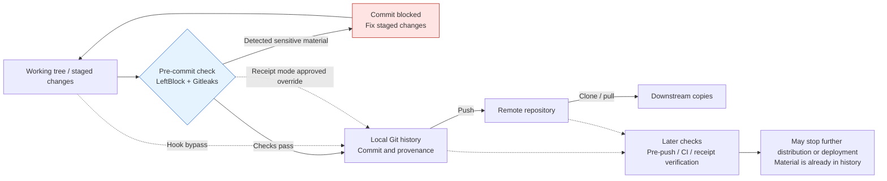
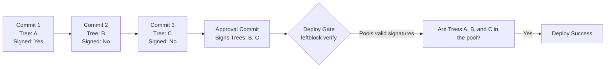

# LeftBlock (formerly Pudicus)

**LeftBlock**, formerly Pudicus, is a pluggable inspection gate for Git commits. It runs configured scanners, including Gitleaks, on staged changes. Local check-only mode blocks findings before a commit; optional receipt mode also records the inspection result in an HMAC receipt.

LeftBlock **shifts privacy checks left**: detected sensitive material can be blocked before it enters a commit and becomes part of local Git history. Pushing distributes that history to a remote; subsequent clones and pulls distribute it further. A later check can stop the next step, but cannot undo copies already made.



Local check-only mode installs a Git **`pre-commit` hook**. Receipt mode installs a **`commit-msg` hook**, which runs later but still before Git creates the commit object. The local hook never offers an override or adds a receipt. The default Gitleaks command scans the staged diff, not every working-tree file or all existing history. Staging may already write blobs to the local object database, so blocking a commit does not erase every local copy.

This is a layered defense, not a guarantee that a repository contains no sensitive information. Scanners can miss formats or context, allowlists and configuration affect coverage, and hooks can be bypassed with `--no-verify` or disabled. In receipt mode, interactive approval can intentionally override findings. Missing scanners, invalid configuration, or other checker errors block the commit without an override. Use review, narrowly scoped exceptions, and independent checks before pushing or deploying as additional layers.

`leftblock verify` validates receipts; it does not rescan content, and a valid receipt can record an approved override. The HMAC binds the recorded result to a tree hash, but anyone who can read the shared secret can mint a receipt. LeftBlock does not itself isolate that secret from an agent running as the same user.

---

## Name and compatibility status

LeftBlock, formerly Pudicus, has been donated to **Data Parade
(`DataParade-io`)**, alongside BotSpy. The repository is now
[DataParade-io/LeftBlock](https://github.com/DataParade-io/LeftBlock).

**LeftBlock 0.3.0 is being prepared and is not yet confirmed published to
PyPI.** It uses the new `leftblock` distribution, Python package, and CLI.
It does not install the `pudicus` package or command, so an existing Pudicus
installation can remain untouched. The existing `pudicus` PyPI project and
releases, including 0.2.0, remain available. Legacy Python shims are retained
only in the source checkout; they are not part of the LeftBlock distribution.

Existing `.pudicus.yml` configuration, `.pudicus/` rule paths,
`PUDICUS_SECRET_PATH`, `pudicus-*` rule IDs, and inspection receipt formats
remain supported. The new CLI is also available as `python -m leftblock.cli`.
A source checkout needs refreshed package metadata to expose the installed
`leftblock` command; an older installed Pudicus launcher does not gain the
new behavior automatically.

## Quick Start

LeftBlock is built in Python and requires `git`. Install Gitleaks separately
from a trusted source and confirm `gitleaks version` works. LeftBlock
configures the integration; it does not install scanner binaries.

**1. Install the CLI:**

After LeftBlock 0.3.0 is published:

```bash
python -m pip install leftblock==0.3.0
```

Before publication, install the reviewed local source containing these
changes with `python -m pip install .`. Do not assume the repository's
`main` branch already contains this release. A GitHub source install must
pin a reviewed feature ref that has actually been pushed; replace the
placeholder below with that ref:

```bash
python -m pip install "git+https://github.com/DataParade-io/LeftBlock.git@<reviewed-feature-ref>"
```

**2. Enable local staged protection:**

```bash
cd my-repo
leftblock install --local --check-only
```

This mode installs a managed `pre-commit` hook and keeps its policy in the
repository's common Git metadata directory. It creates no signing secret,
adds no commit receipts, and writes no tracked repository files. Linked
worktrees share that metadata and hook, so coordinate setup across them.
To select a specific existing Gitleaks executable, pass its absolute path:

```bash
leftblock install --local --check-only --gitleaks "$(command -v gitleaks)"
```

The installer preserves existing hooks and refuses to overwrite a foreign
or edited hook. An unchanged hook managed by LeftBlock can be refreshed.
A configured `core.hooksPath` is left untouched; compose the check explicitly
with the existing hook manager instead of replacing it. Hooks from older
Pudicus versions lack the new ownership record and require a reviewed
migration even if they are still functional.

To run a noninteractive staged check with an explicit policy:

```bash
leftblock check --config /absolute/path/to/policy.yml
```

Use the actual policy path for the repository. The command returns a
nonzero status for findings, unavailable scanners, or an invalid setup;
it never offers an override. Before adopting a hook in another project,
verify that a synthetic sensitive fixture is blocked and a clean fixture
passes in a throwaway repository. Keep private policy files in local Git
metadata or another private location.

**3. Optionally enable inspection receipts:**

```bash
leftblock install
```

Receipt mode installs a `commit-msg` hook, creates a shared secret if one
is absent, and writes defaults when they do not already exist:

- `.pudicus.yml` — checker configuration
- `.pudicus/gitleaks.toml` — the shipped sensitive-data ruleset

Existing checker configuration, rulesets, and other hooks are preserved.
The default receipt-mode configuration uses Gitleaks with redacted output:

```yaml
version: 1
checkers:
  - name: gitleaks
    type: command
    command: gitleaks protect --staged --config .pudicus/gitleaks.toml --redact --no-banner --report-format json --report-path {report_file}
    success_codes: [0]
    finding_codes: [1]
```

The installed hook pins its Python environment and preserves the installation
PATH so it can find configured scanners. Review the hook after moving its
Python environment or Gitleaks executable. For manual composition, run
`leftblock check --config PATH` in the existing `pre-commit` flow and
`leftblock hook "$1"` in the `commit-msg` flow when receipts are needed.
Preserve existing behavior and propagate any failure's exit status.

Receipts use HMAC trailers, not Git GPG/SSH signatures; they do not appear
in `git log --show-signature`. Every machine running `leftblock verify`
needs the same secret, stored by default at `~/.config/pudicus/secret`
or the path in `PUDICUS_SECRET_PATH`. The secret and receipt formats remain
compatible with Pudicus. Local check-only mode does not need this secret.

**4. Add independent checks before distribution or deployment:**

For projects using receipts, verify the appropriate incoming commit range:

```bash
leftblock verify HEAD~5..HEAD
```

Choose the range for the pipeline rather than assuming every push contains
five commits. Receipt verification needs the shared secret and neither
rescans content nor rejects valid overrides. Use an independent secret scan
as another layer. A project using only local check-only mode does not mint
the receipts required by this gate.

---

## Out-of-the-Box Detection

LeftBlock ships a Gitleaks ruleset (copied to `.pudicus/gitleaks.toml` in receipt mode) that
extends gitleaks' default secret rules with personal-data and crypto-wallet
rules. These patterns provide a starting point for detection; they do not
cover every kind of sensitive information.

**Covered by gitleaks defaults:** AWS credential pairs, Google/Gemini API keys
(`AIza...`, default `gcp-api-key` rule), generic API keys in keyword context,
PEM private keys, and other standard secret formats.

**Added by the Pudicus ruleset:**

| Rule | What it catches |
|---|---|
| `pudicus-personal-email` | Personal email addresses (infrastructure identities like `git@github.com`, `@users.noreply.github.com` and `@example.*` placeholders are allowlisted) |
| `pudicus-home-path-posix` | Home-folder paths `/Users/<name>`, `/home/<name>` |
| `pudicus-home-path-windows` | `C:\Users\<name>` and `\Users\<name>` |
| `pudicus-session-uuid` | Bare UUIDs outside structural id fields (Kanbus `id`-style fields are allowlisted; a UUID in `session_id`-style fields or free text is reported) |
| `pudicus-actor-id` | `actor_id` / `user_id` / `author_id` JSON values |
| `pudicus-openai-key` | `sk-`, `sk-proj-`, `sk-svcacct-` OpenAI keys |
| `pudicus-anthropic-key` | `sk-ant-` Anthropic keys |
| `pudicus-eth-private-key` | Ethereum-style private keys (`0x` + 64 hex) |
| `pudicus-wif-key` | Bitcoin WIF private keys (compressed `K/L/M…`, uncompressed `5…`) |
| `pudicus-bip39-mnemonic` | BIP-39 seed phrases (12–24 words) in seed/mnemonic/recovery context |

### Crypto wallet material: what is and is not flagged

- **Flagged:** `0x`-prefixed 64-hex private keys, WIF-format Bitcoin keys,
  and 12/15/18/21/24-word BIP-39 seed phrases when they appear in
  seed/mnemonic context (`seed_phrase = "..."`, `recovery mnemonic: ...`).
- **Not flagged on their own:** public wallet addresses (Ethereum `0x` + 40
  hex, Bitcoin base58 addresses) and hash-like hex — SHA-256 digests, git
  SHAs, SHA-512. A bare 64-hex string with no `0x` prefix and no key-like
  keyword is shape-identical to a SHA-256 digest and git SHA, so it is
  deliberately only reported when keyword context (e.g. `private_key = …`)
  indicates it is a key. This trades a small residual gap (a bare,
  unlabeled 64-hex private key stored without any keyword) for not
  drowning developers in digest false positives. BIP-39 checksum
  validation is future validator work; phrase detection is shape- and
  context-based, so unlabeled bare word sequences that read like prose
  are not flagged.

### Why Gitleaks is the default checker

The earlier scanner evaluation used a synthetic fixture corpus, clean
content, and a ~2 MB repository tree. Gitleaks results below include the
Pudicus ruleset; these measurements describe that corpus, not a guarantee
about other repositories or scanner versions:

| Scanner | Verdict |
|---|---|
| **Gitleaks 8.30.1** (default checker) | Catches API keys, crypto keys (with the Pudicus ruleset), and personal data via custom rules; deterministic exit codes (0 clean / 1 findings); zero false positives on clean content and on the real tree with the shipped ruleset; fast (~35 ms on 2 MB). |
| detect-secrets | No OpenAI/AWS-type detector hits for these formats — findings appear only as generic "High Entropy String"/"Secret Keyword"; misses mnemonics and all personal data; exit code 0 even with findings, so not gate-suitable without a wrapper. |
| TruffleHog (offline) | Its AWS detector caught the credential pair, but nothing else offline (OpenAI/Anthropic/Gemini/crypto/personal data all missed); scans git objects including gitignored files, which produces a different, noisier finding set; no allowlist mechanism for custom detectors. |
| Presidio | Built for PII text analytics; requires a 500 MB model, flags benign URLs/IPs/timestamps while missing every target category here (including `.test`-TLD emails and keys); unsuitable for commit gating. |

False-positive measurements with the shipped ruleset: **0 findings** on a
clean corpus (benign source/config files, placeholder emails and paths that
must stay allowed) and **0 findings** on a ~2 MB real repository tree
(PUDICUS_DOGFOOD_TREE dogfood test). The unit-test suite
(`tests/test_sensitive_rules.py`) regenerates all fixtures synthetically at
test time from a seeded RNG — no real credential ever appears in the repo.

---

## Custom Agent-Based Scanning (Tactus)

While standard tools like Gitleaks are great for finding AWS IAM keys, they struggle with subtle, context-dependent leaks—like mentioning a confidential client's name or proprietary business logic.

LeftBlock supports **Tactus procedures** for agent-based code review.

### Example: Protecting Confidential Client Names
Imagine you have a list of highly confidential clients that should never be mentioned in your repository's source code.

1. Create a `.gitignored` file named `confidential_clients.txt`.
2. Write a Tactus procedure (e.g., `check_clients`) that reads `confidential_clients.txt` and scans the staged files to ensure none of those names appear.
3. Add the procedure to your `.pudicus.yml`:

```yaml
version: 1
checkers:
  - name: tactus-confidentiality-scan
    type: tactus
    procedure: check_clients
```

In receipt mode, LeftBlock invokes a configured Tactus checker when a commit is made. If Tactus finds a leaked client name, it exits with an error, LeftBlock blocks the commit, and prompts a human for an override password. If the code is clean, the signature is minted and the commit proceeds.

---

## Deep Dive: How it works

### 1. The Commit Hook
Receipt mode uses a shared HMAC secret.

In receipt mode, before Git creates the commit, LeftBlock:

1. Computes the hash of the staged Git tree.
2. Runs the configured scanners. The default Gitleaks command checks the staged diff; custom checkers define their own scope.
3. If checks pass, records the result and tree hash in an HMAC receipt and appends it to the commit message as Git trailers. An approved interactive override is recorded as an override, not as a clean result.

The tree hash identifies the staged snapshot. It does not imply that the
scanner examined every file in that snapshot or the repository's history.

```text
Inspected-by: pudicus-v1
Inspection-tree: f18588e0c5f5b0a5ba281b5a78242127919d2388
Inspection-result: clean
Inspection-at: 2026-08-31T17:01:34Z
Inspection-sig: hmac-sha256:8cce6e3714782d025eb4ec4aec755...
```

### 2. Retroactive Approval (Signature Pooling)
Because Git commit hashes change if you modify a commit message, you cannot simply add signatures to old commits without rewriting history (e.g., `git rebase`).

To support later receipts, LeftBlock ties the signature to the **Tree Hash** (the codebase state) rather than the **Commit Hash**.

If an agent bypasses the hook with `--no-verify`, or if you are onboarding an older project, you can run `leftblock approve`. This creates an empty "paperwork" commit at the tip of your branch that holds the signatures for the older commits.



Retroactive receipts preserve commit history, but do not remove sensitive material from existing commits or copies. They document a later inspection or approval; they cannot provide the same early interception as a check before the original commit.
